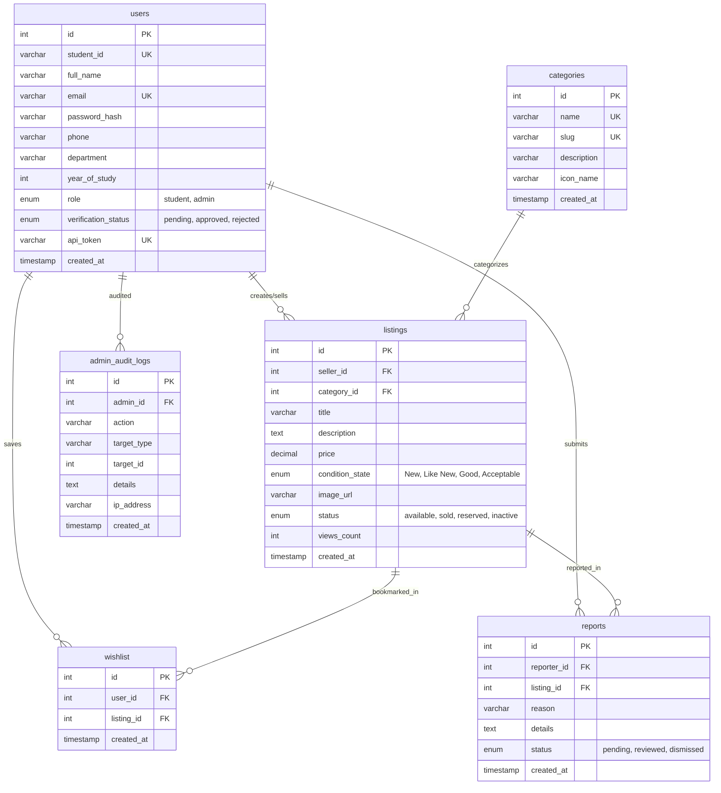

# Peer-to-Peer Campus Marketplace

A full-stack, campus-exclusive desktop and web marketplace designed for university students to buy, sell, and exchange used academic resources (engineering textbooks, scientific calculators, lab coats, bicycles, lab equipment, and graphics drafting tools) safely within their collegiate community.

---

## 📸 Interface Preview & Design Inspiration

The desktop application and web module are built with a modern dark theme with vivid orange accents (`#F26440` / `#FF6B35`), responsive product card grids, condition pills (`GOOD`, `NEW`, `LIKE NEW`, `ACCEPTABLE`), Indian Rupee pricing (`₹`), seller credentials, and student verification indicators.

---

## 🏛️ System Architecture

The platform adheres to a clean **3-Tier Client-Server Architecture**:

```
+-------------------------------------------------------+
|                 1. PRESENTATION TIER                  |
|  Java Swing GUI (FlatLaf Dark Theme, Desktop Client)  |
|         or Web Learning Client-Side Portal            |
+---------------------------+---------------------------+
                            |
                   HTTP/JSON REST API
                 (Bearer Authentication)
                            |
+---------------------------v---------------------------+
|                  2. APPLICATION TIER                  |
|                 PHP 8.3+ REST API                     |
| (Front Controller, Auth Middleware, RBAC Controller)  |
+---------------------------+---------------------------+
                            |
                     PDO Prepared Stmts
                       (TCP Port 3306)
                            |
+---------------------------v---------------------------+
|                    3. DATA TIER                       |
|               MySQL / MariaDB 10.4+                   |
| (users, categories, listings, wishlist, reports, logs)|
+-------------------------------------------------------+
```

> **Viva Note on Architecture:**
> - **Main Application:** Java Swing communicates **strictly through HTTP REST APIs** with the PHP backend. PHP communicates with MySQL using PDO with prepared statements. Java Swing *never* connects directly to MySQL.
> - **JDBC Demonstration Module:** A separate standalone module demonstrates raw 2-tier database connectivity (`DriverManager`, `Statement`, `PreparedStatement`, `ResultSet`, `Transaction Management`) for academic syllabus criteria.

---

## 🗄️ Database Design (Mermaid ER Diagram)



### Purpose of Database Tables

| Table | Purpose |
|---|---|
| `users` | Stores student and admin credentials, bcrypt password hashes, academic department, and administrator verification statuses (`pending`, `approved`, `rejected`). |
| `categories` | Organizes campus essentials (Books, Calculators, Electronics, Lab Equipment, Bicycles, Lab Coats, Drawing Tools). |
| `listings` | Item titles, descriptions, prices, condition ratings, view counters, availability status, and seller foreign keys. |
| `wishlist` | Bookmarks saved by students for items they plan to purchase, with unique compound constraint `(user_id, listing_id)`. |
| `reports` | Inappropriate item or prohibited listing flags filed by students for administrative review. |
| `admin_audit_logs` | Immutable security log tracking verification approvals, rejections, and moderation deletions with admin ID and IP. |

---

## 🛠️ Technology Stack

- **Desktop GUI:** Java 17+ / Java 26 (Swing, FlatLaf Dark Theme, Non-blocking `SwingWorker`)
- **Backend API:** PHP 8+ (PSR-4 routing, PDO, Prepared Statements, Bcrypt)
- **Database:** MySQL / MariaDB (InnoDB, Foreign Keys, Indexes)
- **Build Tool:** Apache Maven 3.9+
- **Syllabus Module 1 (JDBC):** MySQL Connector/J 8.3+, try-with-resources CRUD
- **Syllabus Module 2 (Web):** Semantic HTML5, CSS Grid, Flexbox, Vanilla JavaScript ES6+

---

## 🚀 Quick Start Guide (Windows)

### Prerequisites
1. **XAMPP** installed at `C:\xampp` (providing Apache, MySQL/MariaDB, and PHP).
2. **Java JDK 17+** (Installed at `C:\Program Files\Java\jdk-26.0.1` or on system PATH).

### 1. Launch Entire Application with 1-Click
Double click **`run-app.bat`** in the project root:
- Checks and starts MySQL daemon (port 3306).
- Checks and starts PHP REST API server on `http://127.0.0.1:8000`.
- Launches the Java Swing Desktop Client.

## ☁️ Deploy the Web App on Railway

The repository-root `Dockerfile` deploys the static web client and PHP REST API
as one Railway web service. Railway's MySQL service is a separate service and
must be added to the project; the Java Swing desktop client and JDBC demo are
not web services and are not included in this deployment.

1. Create a Railway project from this GitHub repository and leave the service
   **Root Directory** set to the repository root.
2. Add a Railway **MySQL** service to the same project.
3. In the web service's Variables, add references to the MySQL service:

   | Variable | Reference |
   |---|---|
   | `DB_HOST` | `${{MySQL.MYSQLHOST}}` |
   | `DB_PORT` | `${{MySQL.MYSQLPORT}}` |
   | `DB_NAME` | `${{MySQL.MYSQLDATABASE}}` |
   | `DB_USER` | `${{MySQL.MYSQLUSER}}` |
   | `DB_PASS` | `${{MySQL.MYSQLPASSWORD}}` |

   If you named your database service something other than `MySQL`, replace
   `MySQL` in each reference with that service's name.
4. Deploy. Railway builds the root `Dockerfile`; the site is available at the
   generated domain, and the API health endpoint is `/api/health`.

The PHP API initializes the tables and seed data on its first connection to an
empty database. Do not deploy the Java desktop app to Railway; it requires a
desktop environment.

### Deploy on Render

Create a **Web Service** from this repository, choose **Docker**, and leave
**Root Directory** blank so Render uses the root `Dockerfile`. Configure
`DB_HOST`, `DB_PORT`, `DB_NAME`, `DB_USER`, and `DB_PASS` with connection
details for a MySQL database reachable from Render. Render's free web service
can sleep when idle; it does not provide the MySQL database required by this
application. Do not set `DB_HOST` to `localhost` or `127.0.0.1`; those point
back to the web-service container, not to a separate database. If the page
reports `DB_CONNECTION_ERROR` or `SQLSTATE[HY000] [2002] Connection refused`,
check the Render service logs and verify all five database variables with your
MySQL provider. The MySQL host must accept connections from Render.

The web client starts with login and registration forms, validates sessions
through the PHP API, loads marketplace listings/categories from the database,
and submits listings through the API. Newly registered student accounts remain
pending until an administrator approves them; only approved students can post.

---

## 🔑 Pre-Configured Test Accounts (Viva Presets)

The login screen provides **1-click quick-fill buttons** for viva demonstration:

| Role | Account Name | Email | Password | Status / Permissions |
|---|---|---|---|---|
| **Administrator** | Prof. Sharma | `admin@campus.edu` | `Admin@123` | Full admin privileges: approve/reject verifications, moderate listings, view audit logs. |
| **Verified Student 1** | Atharva Gokhale | `atharva@campus.edu` | `Student@123` | Approved student: can create listings, save wishlist, edit own items. |
| **Verified Student 2** | Janhavi Patil | `janhavi@campus.edu` | `Student@123` | Approved student: seller of Lab Coat & Hero Sprint bicycle. |
| **Verified Student 3** | Yash Deshmukh | `yash@campus.edu` | `Student@123` | Approved student: seller of engineering graphics tools & roller scales. |
| **Pending Student** | Rohit Kulkarni | `rohit@campus.edu` | `Student@123` | **Pending Approval**: demonstrating restriction enforcement (cannot create listings until approved by admin). |

---

## 🧪 Running Automated Tests

Run the comprehensive automated API test suite covering 18 integration scenarios:

```powershell
# In PowerShell:
C:\xampp\php\php.exe tests\api_smoke_test.php
```

**Test Coverage:**
- ✅ 1. Health check endpoint (200 OK)
- ✅ 2. Categories listing
- ✅ 3. Student authentication & session token issuance
- ✅ 4. Invalid password rejection (401 Unauthorized)
- ✅ 5. Admin authentication & role assignment
- ✅ 6. New student registration with default `pending` status
- ✅ 7. Duplicate email prevention (409 Conflict)
- ✅ 8. Role-based enforcement blocking unverified students from posting listings (403 Forbidden)
- ✅ 9. Administrator approval of pending student
- ✅ 10. Newly approved student posting live listing
- ✅ 11. Multi-parameter search & category filter queries
- ✅ 12. Ownership security check preventing editing another student's listing (403 Forbidden)
- ✅ 13. Owner updating their own listing price and condition
- ✅ 14. Wishlist add and duplicate check
- ✅ 15. Wishlist removal
- ✅ 16. Regular students blocked from accessing admin dashboard (403 Forbidden)
- ✅ 17. Administrator accessing system metrics and KPIs
- ✅ 18. Destructive deletion with cascading cleanup

---

## 🔬 Syllabus Module 1: JDBC Demonstration

To demonstrate raw Java Database Connectivity without the REST layer:

```powershell
# Double-click run-jdbc-demo.bat or run:
.\run-jdbc-demo.bat
```

Demonstrates:
- `Class.forName("com.mysql.cj.jdbc.Driver")`
- `DriverManager.getConnection(...)` with try-with-resources
- `Statement` and `ResultSet` for category querying
- `PreparedStatement` with auto-generated keys (`Statement.RETURN_GENERATED_KEYS`)
- Parameterized `SELECT`, `UPDATE`, and `DELETE`
- Transaction management with `setAutoCommit(false)`, in-memory mutation, and `rollback()`.

---

## 🌐 Syllabus Module 2: HTML/CSS/JavaScript Client-Side Lab

Located in `web-learning/`:
1. Open `web-learning/index.html` in any web browser.
2. Features:
   - **Tab 1: Product Grid** — Responsive CSS Grid matching the project screenshot with live client-side search, category filter buttons, and price sort.
   - **Tab 2: Item Submission Form** — Form labels, diverse HTML5 input controls (text, email, number, select, radio group, checkbox), and custom JavaScript regex validation.
   - **Tab 3: JS Code Lab** — Live interactive playground demonstrating variables, arithmetic operators, conditionals (`if/else` and `switch`), higher-order array methods (`filter`, `map`, `reduce`), and dynamic DOM manipulation (`createElement`, `appendChild`, element removal).

---

## 📁 Project Directory Structure

```
campus-marketplace/
├── backend-php/
│   ├── config/
│   │   ├── Config.php
│   │   └── Database.php
│   ├── public/
│   │   ├── index.php         (Front Controller & REST Router)
│   │   └── router.php        (Built-in Dev Server Router)
│   └── src/
│       ├── Controllers/      (Auth, Listing, Wishlist, Admin, Seller, Report)
│       ├── Middleware/       (AuthMiddleware, Verification Gate, Admin Gate)
│       └── Utils/            (Response, Validator)
├── database/
│   ├── schema.sql            (DDL table schemas, foreign keys, indexes)
│   └── seed.sql              (Realistic fictional campus seed data)
├── frontend-java/
│   ├── pom.xml               (Maven project configuration)
│   └── src/main/java/com/campus/marketplace/
│       ├── Main.java         (Entry point with FlatLaf initialization)
│       ├── config/           (AppConfig & Session Manager)
│       ├── models/           (User, Listing, Category, WishlistItem, Report, etc.)
│       ├── service/          (ApiClient, AuthService, MarketplaceService, AdminService)
│       ├── ui/
│       │   ├── ModernTheme.java
│       │   ├── MainFrame.java
│       │   ├── components/   (ProductCardPanel)
│       │   ├── dialogs/      (AddListingDialog, EditListingDialog, ProductDetailsDialog)
│       │   └── panels/       (Marketplace, Login, Register, Wishlist, Seller, Admin, etc.)
│       └── util/             (SwingWorkerHelper)
├── jdbc-demo/
│   ├── run-demo.bat
│   └── src/main/java/com/campus/jdbc/JdbcMarketplaceDemo.java
├── web-learning/
│   ├── index.html
│   ├── style.css
│   └── script.js
├── tests/
│   └── api_smoke_test.php    (Automated 18-step HTTP test suite)
├── docs/
│   └── PROJECT_REPORT.md     (Comprehensive Academic College Report)
├── run-app.bat               (1-Click Master Application Launcher)
├── start-backend.bat         (Backend starter)
├── run-frontend.bat          (Desktop client launcher)
├── run-jdbc-demo.bat         (JDBC demo launcher)
└── README.md
```
